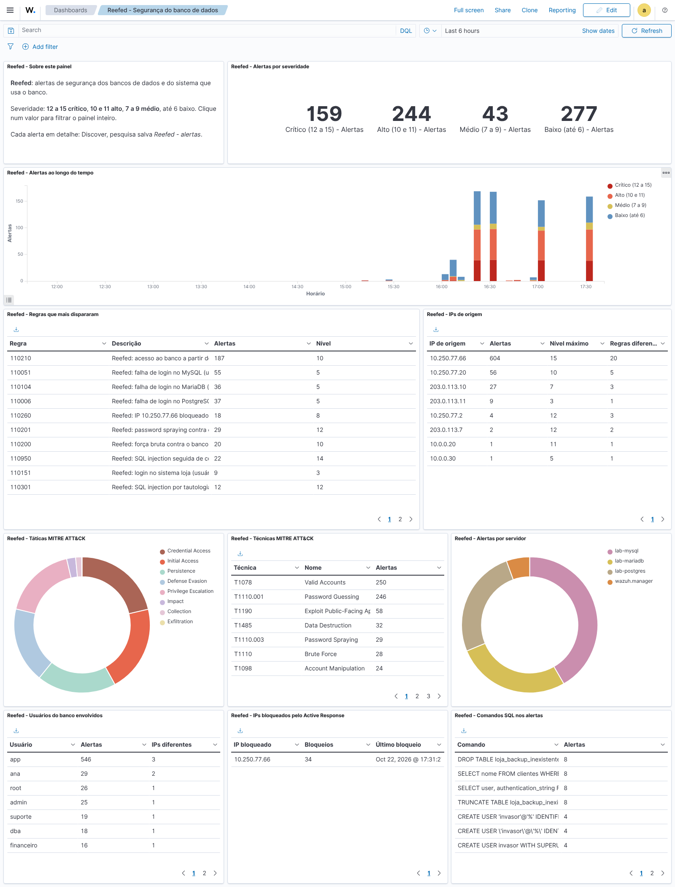
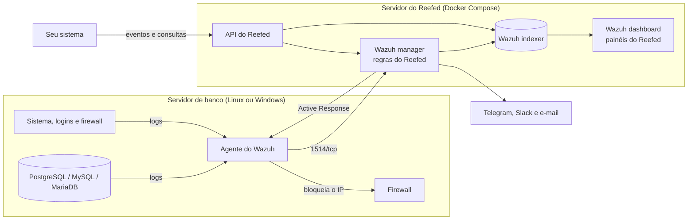

# Reefed

**SIEM para bancos de dados, baseado no [Wazuh](https://wazuh.com) 4.14.**

O Reefed vigia servidores PostgreSQL, MySQL e MariaDB e o sistema que usa esses bancos.
Ele junta os logs do banco, do sistema operacional, da autenticação e do firewall,
reconhece ataques com 145 regras próprias mapeadas no MITRE ATT&CK e avisa por Telegram,
Slack e e-mail. Quando alguém tenta adivinhar senhas, o IP é bloqueado no firewall do
servidor de banco. Uma API deixa o seu sistema mandar eventos (login, exportação, troca
de perfil) e consultar alertas e status.

Tudo sobe com Docker Compose num servidor só, e um laboratório simula os ataques para
provar que as regras funcionam (`make lab`).



## O que o Reefed detecta

| Ameaça | Exemplos | Regras |
|---|---|---|
| Força bruta no banco | 5 falhas de login em 2 minutos do mesmo IP, password spraying, várias origens contra o mesmo usuário, login aceito depois das falhas | 110200 a 110203 |
| Acesso de IP desconhecido | login de um IP fora da lista `trusted-db-clients`, com nível maior se a conta for de administrador | 110210, 110211 |
| Login fora do horário | fora de `REEFED_OFF_HOURS` ou em fim de semana, combinado com IP desconhecido | 110900 a 110903 |
| SQL injection | tautologia (`OR 1=1`), `UNION SELECT`, comando empilhado, por tempo (`pg_sleep`, `SLEEP`), por erro, comentário cortando o comando, ofuscação, rajada de erros de sintaxe | 110300 a 110315 |
| Comandos destrutivos inesperados | `DROP DATABASE`, `DROP TABLE`, `TRUNCATE`, `ALTER TABLE ... DROP`, `DELETE`/`UPDATE` sem `WHERE`, com nível maior se quem rodou não é administrador | 110400 a 110427 |
| Usuários e privilégios | usuário criado, superusuário, `GRANT ALL`, `WITH GRANT OPTION`, usuário que aceita qualquer host (`'%'`), mudança direta na tabela de usuários | 110500 a 110521 |
| Exportação em massa | `INTO OUTFILE`, `COPY TO`, `pg_dump`/`mysqldump`, consulta que devolve muitas linhas, muitas tabelas lidas inteiras | 110600 a 110612 |
| Execução e evasão | `COPY ... PROGRAM`, funções com código nativo, leitura de arquivos do servidor, leitura dos hashes de senha, auditoria desligada, log binário apagado | 110700 a 110734 |
| Integridade dos arquivos (FIM) | `pg_hba.conf`, `postgresql.conf`, `my.cnf`/`my.ini`, plugins e extensões, chaves TLS, log do banco apagado, `skip-grant-tables` | 110800 a 110805, 110056 |
| Eventos do seu sistema | login, falha, acesso negado, exportação, exclusão em lote, troca de perfil e SQL injection bloqueada, enviados pela API | 110150 a 110173 |
| Ataque em várias etapas | SQL injection seguida de `DROP` ou de exportação; força bruta seguida de `GRANT`, `DROP` ou dump | 110950 a 110954 |
| Firewall e bloqueios | conexões barradas nas portas do banco, insistência da mesma origem, bloqueio e desbloqueio pelo Active Response | 110250 a 110261 |

As regras padrão do Wazuh continuam ligadas e cobrem o resto do servidor: SSH, `sudo`,
logon do Windows, Defender, rootkits e outras. O catálogo completo, com nível e técnica
MITRE de cada regra, está em [docs/regras.md](docs/regras.md).

## Como funciona



- O **agente** do Wazuh lê os logs do banco e do sistema e manda para o manager.
- O **manager** decodifica cada log, aplica as regras do Reefed e as do Wazuh, manda os
  alertas para o indexer e para os canais de notificação, e pede ao agente que bloqueie o
  IP de quem faz força bruta.
- O **dashboard** mostra o painel "Reefed - Segurança do banco de dados".
- A **API do Reefed** é a porta de entrada do seu sistema: ela não expõe o indexer nem a
  API do Wazuh.

Mais detalhes em [docs/arquitetura.md](docs/arquitetura.md).

## Requisitos

- Linux com Docker Engine e Docker Compose v2. No Windows, use o Docker Desktop com o
  WSL 2 e rode os comandos dentro do Ubuntu do WSL.
- 4 GB de RAM livres (8 GB recomendados), 2 CPUs e uns 15 GB de disco para as imagens,
  além do espaço dos alertas.
- Portas: 443 (dashboard), 8000 (API do Reefed), 1514 e 1515 (agentes) e, se for receber
  syslog de firewalls, 514/udp.

## Começando

Na pasta do repositório:

```bash
./setup.sh     # cria o .env com senhas aleatórias, os certificados TLS e os usuários do indexer
make up        # sobe manager, indexer, dashboard e API, e espera tudo responder
```

Na primeira vez o `make up` leva alguns minutos (o indexer demora para iniciar). No fim
ele mostra:

```
[reefed] Wazuh v4.14.9: manager, indexer e API no ar
[reefed] agentes: 0 ativo(s), 0 desconectado(s), 0 nunca conectado(s)
[reefed] alertas nas últimas 24 h: 0 (crítico 0, alto 0, médio 0, baixo 0)
[reefed] notificações: nenhum canal configurado (Telegram, Slack ou e-mail: docs/alertas.md)
[reefed] dashboard: https://localhost:443  (usuário admin, senha INDEXER_PASSWORD do .env)
[reefed] API do Reefed: http://localhost:8000/docs  (cabeçalho X-API-Key com a REEFED_API_KEY do .env)
```

O certificado do dashboard é gerado pelo `setup.sh`, então o navegador avisa que não
conhece quem o assinou. Os painéis do Reefed são importados sozinhos; abra o menu
**Dashboards > Reefed - Segurança do banco de dados**.

Sem o `make`: `docker compose up -d --build` e depois `scripts/status.sh`.

## Agentes

A senha de registro é a `REEFED_ENROLLMENT_PASSWORD` do `.env`.

Servidor Linux (com `--db` se for o servidor do banco):

```bash
sudo ./agents/linux/install-agent.sh --manager IP_DO_REEFED --password SENHA --db postgresql
```

Servidor Windows (PowerShell aberto como administrador):

```powershell
.\agents\windows\install-agent.ps1 -Manager IP_DO_REEFED -Password SENHA -Database mysql
```

O instalador do Windows acha o banco pelo serviço do Windows, configura os logs e o
FIM com os caminhos daquela instalação e liga o log do firewall e a auditoria de logon.

Depois, ligue no banco o log no formato que o Reefed entende, com os arquivos de
`agents/database/` (um por banco). O passo a passo, inclusive para banco em Docker, está
em [docs/agentes.md](docs/agentes.md).

## Alertas

Preencha no `.env` os canais que for usar e rode `make restart`:

```bash
TELEGRAM_BOT_TOKEN=123456:ABC...      # bot criado no @BotFather
TELEGRAM_CHAT_ID=-100123456789
SLACK_WEBHOOK_URL=https://hooks.slack.com/services/...
SMTP_HOST=smtp.gmail.com              # mais SMTP_USER, SMTP_PASSWORD, SMTP_FROM, ALERT_EMAIL_TO
```

Por padrão o Telegram e o Slack recebem alertas a partir do nível 10 e o e-mail a partir
do 12. Alertas repetidos (mesma regra, servidor e origem) viram uma mensagem a cada 10
minutos, com a contagem do que foi agrupado. Veja [docs/alertas.md](docs/alertas.md).

## Integração com o seu sistema

O seu sistema fala com a API do Reefed (`http://IP_DO_REEFED:8000`) com o cabeçalho
`X-API-Key`:

```bash
# alertas graves da última hora
curl -H "X-API-Key: $REEFED_API_KEY" "http://localhost:8000/api/v1/alerts?since=1h&min_level=10"

# avisa o Reefed de uma falha de login no sistema
curl -X POST -H "X-API-Key: $REEFED_API_KEY" -H "Content-Type: application/json" \
  -d '{"app": "loja", "event": "login_failed", "user": "ana", "srcip": "203.0.113.7"}' \
  http://localhost:8000/api/v1/events
```

`api/client/` tem clientes prontos, sem dependências, em Python, JavaScript (Node.js),
Java e PHP. Copie o da linguagem do seu sistema:

```python
from reefed_client import ReefedClient

reefed = ReefedClient("http://IP_DO_REEFED:8000", api_key="...")
reefed.notify("loja", "data_export", user="ana", srcip="203.0.113.7", records=5000)
for alerta in reefed.alerts(since="1h", min_level=10)["items"]:
    print(alerta["severity"], alerta["rule"]["description"])
```

O guia de integração, com exemplos nas quatro linguagens e o que configurar no banco do
seu projeto, está em [docs/integracao.md](docs/integracao.md). A referência da API está
em [docs/api.md](docs/api.md) e em `http://localhost:8000/docs`.

## Laboratório de ataques

```bash
make lab
```

O laboratório sobe PostgreSQL 17, MySQL 8.4 e MariaDB 11.4 com agentes, gera tráfego
normal de uma aplicação e depois ataca: força bruta, password spraying, SQL injection,
comandos destrutivos, criação de superusuário, leitura de hashes, exfiltração, backdoor
no `pg_hba.conf`, `skip-grant-tables` e apagar log. No fim ele confere 15 itens (alertas,
bloqueio do IP do atacante e mensagens que chegaram a um receptor falso de Telegram,
Slack e e-mail) e termina com erro se algum falhar. Veja [lab/README.md](lab/README.md).

## Comandos

Rode `make` sozinho para ver a lista.

| Comando | O que faz |
|---|---|
| `make setup` | primeira vez: `.env` com senhas, certificados e usuários do indexer |
| `make up` | sobe o Reefed e espera ficar pronto |
| `make status` | mostra se está tudo no ar, os agentes e os alertas das últimas 24 h |
| `make down` | para o Reefed (os dados ficam nos volumes) |
| `make restart` | reinicia o manager (relê o `.env`, as regras e as integrações) |
| `make passwords` | aplica as senhas e chaves do `.env` depois de trocar alguma |
| `make backup` | backup do `.env`, dos certificados e de todos os volumes em `backups/` |
| `make logs S=wazuh.manager` | acompanha os logs de um serviço |
| `make agents` | lista os agentes e o estado de cada um |
| `make deploy-rules` | aplica mudanças em regras, decoders, listas e integrações |
| `make test-rules` | testa as regras no `wazuh-logtest` (236 casos) |
| `make test` | testes da API, das integrações e dos caminhos do FIM |
| `make dashboards` | importa ou atualiza os painéis do Reefed |
| `make api-test` | consulta a API com a chave do `.env` |
| `make lab` | laboratório completo; também `lab-up`, `lab-attack`, `lab-validate` e `lab-down` |

O dia a dia (troca de senhas, backup e restauração, retenção dos alertas, atualização do
Wazuh, certificados, problemas comuns) está em [docs/operacao.md](docs/operacao.md).

## Estrutura

```
docker-compose.yml        manager, indexer, dashboard, API do Reefed e reefed-init
setup.sh                  senhas, certificados e usuários do indexer
.env.example              todas as opções, comentadas
config/                   ossec.conf do manager (modelo), indexer, dashboard e reefed-init
wazuh/
  decoders/               PostgreSQL, MySQL e MariaDB
  rules/                  as regras do Reefed (110000 a 119999)
  lists/                  trusted-db-clients e db-admins
  shared/                 configuração dos grupos de agentes (linux, windows, database, app...)
  integrations/           Telegram, Slack e e-mail
agents/
  linux/                  instalador do agente para Linux
  windows/                instalador do agente para Windows (PowerShell)
  database/               configuração de log de cada banco
api/                      API do Reefed (FastAPI) e clientes em Python, JavaScript, Java e PHP
dashboards/               painéis do dashboard e o script que os gera
lab/                      laboratório de ataques
tests/                    testes das regras, da API, das integrações e do instalador Windows
docs/                     documentação
scripts/                  scripts usados pelo Makefile
```

## Testes

- `make test-rules`: 236 casos com logs reais, conferindo decoder, regra, nível, campos
  e MITRE, em todas as janelas de horário.
- `make test`: testes da API, das integrações de alerta e dos caminhos que as regras de
  FIM reconhecem.
- `make lab`: o sistema inteiro, de ponta a ponta, com ataques de verdade.
- O CI do GitHub (`.github/workflows/ci.yml`) roda tudo isso a cada push, mais shellcheck,
  validação dos XML e do Compose, e o instalador do Windows num Windows de verdade. O
  laboratório completo roda sob demanda (Actions > CI > Run workflow).

## Segurança do próprio Reefed

- O `.env` guarda todas as senhas e fica fora do git. O `setup.sh` gera senhas fortes.
- A API do Wazuh e o indexer só escutam em `127.0.0.1`. De fora, só o dashboard (443), a
  API do Reefed (8000) e as portas dos agentes.
- A API do Reefed fala HTTP. Fora de uma rede de laboratório, coloque um proxy com HTTPS
  na frente (veja [docs/api.md](docs/api.md)) ou deixe `REEFED_API_BIND=127.0.0.1` se o
  sistema roda no mesmo servidor. Para quem só consulta, use a chave somente leitura
  `REEFED_API_READ_KEY`.
- Limite no firewall do servidor quem alcança as portas 1514/1515 (servidores com agente)
  e 443/8000 (quem administra e o seu sistema).

## Documentação

- [docs/arquitetura.md](docs/arquitetura.md): componentes, portas, volumes e o caminho de um log até o alerta
- [docs/agentes.md](docs/agentes.md): agentes Linux e Windows e configuração de log de cada banco
- [docs/regras.md](docs/regras.md): catálogo de regras, níveis, listas, MITRE e como mudar uma regra
- [docs/alertas.md](docs/alertas.md): Telegram, Slack e e-mail
- [docs/active-response.md](docs/active-response.md): bloqueio automático de IPs
- [docs/api.md](docs/api.md): referência da API do Reefed
- [docs/integracao.md](docs/integracao.md): como ligar o Reefed ao sistema do seu projeto
- [docs/operacao.md](docs/operacao.md): dia a dia, backup, atualização e problemas comuns
- [lab/README.md](lab/README.md): laboratório de ataques

## Licença

[MIT](LICENSE). O Reefed usa as imagens oficiais do Wazuh sem modificá-las; o Wazuh é
distribuído pelos seus autores sob a licença GPL v2.
