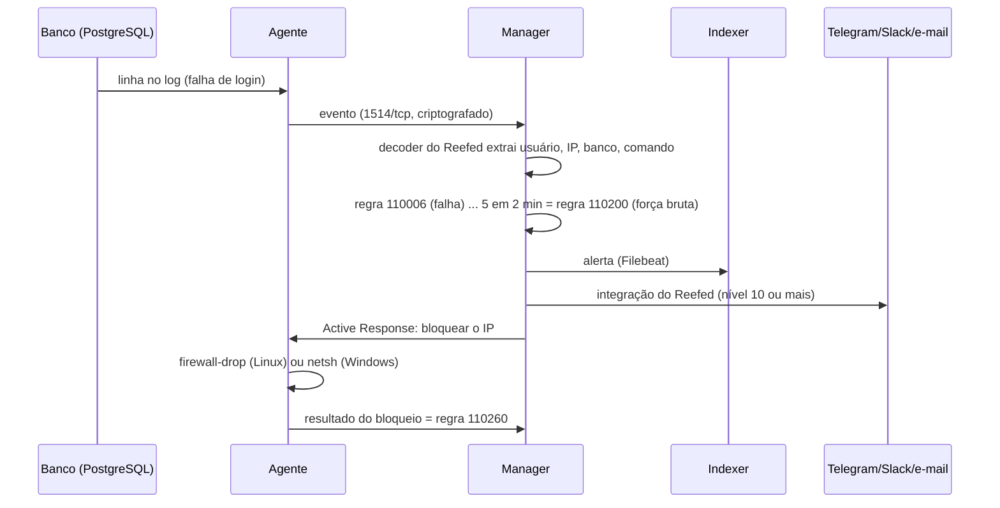

# Arquitetura

O Reefed é o Wazuh 4.14 em Docker Compose (instalação de um nó só) mais o que torna
o Wazuh um SIEM de banco de dados: decoders e regras para PostgreSQL, MySQL e MariaDB,
configuração dos agentes por grupo, integrações de alerta, Active Response, uma API
própria, painéis e um laboratório de ataques.

## Containers

| Serviço | Imagem | Papel |
|---|---|---|
| `wazuh.manager` | `wazuh/wazuh-manager` | Recebe os eventos dos agentes, aplica decoders e regras, gera os alertas, manda notificações e ordens de bloqueio |
| `wazuh.indexer` | `wazuh/wazuh-indexer` (OpenSearch) | Guarda os alertas, um índice por dia (`wazuh-alerts-4.x-AAAA.MM.DD`) |
| `wazuh.dashboard` | `wazuh/wazuh-dashboard` (OpenSearch Dashboards) | Interface web com os painéis do Reefed e os do Wazuh |
| `reefed-api` | construída de `api/` | API do Reefed: o seu sistema consulta alertas e manda eventos por ela |
| `reefed-init` | a mesma da API | Roda a cada `up` e termina: instala o modelo de índice e importa os painéis |

As versões das imagens do Wazuh vêm de `WAZUH_VERSION` no `.env`.

## O caminho de um log até o alerta

1. **Coleta.** O agente lê os logs do banco com a configuração do grupo do banco
   (`wazuh/shared/postgresql/agent.conf`, por exemplo). Comandos SQL de várias linhas
   viram um evento só (`multi-line-regex`). O agente também acompanha os arquivos de
   configuração do banco (FIM) e, no MySQL/MariaDB, roda a verificação de
   `skip-grant-tables`.
2. **Decodificação.** Os decoders do Reefed (`wazuh/decoders/`) separam data, processo,
   usuário, banco, IP do cliente, aplicação, comando, código de erro e linhas
   devolvidas. Eles se chamam `0011-` a `0013-` porque o Wazuh carrega os decoders de
   todas as pastas em ordem alfabética do nome do arquivo e o primeiro que reconhece o
   log fica com ele: assim os do Reefed vêm depois dos decoders genéricos do Wazuh
   (JSON e Active Response) e antes dos decoders simples de MySQL e PostgreSQL do Wazuh.
3. **Regras.** As regras do Reefed (`wazuh/rules/`) partem de uma regra base por banco e
   sobem de nível conforme o comando, o usuário (lista `db-admins`), o IP (lista
   `trusted-db-clients`), o horário e a repetição. As regras de correlação juntam
   etapas de um ataque vindas do mesmo IP. Veja [regras.md](regras.md).
4. **Alerta.** O manager grava o alerta em `alerts.json`; o Filebeat do container manda
   para o indexer. O id de cada alerta no indexer é tirado do conteúdo da linha, então a
   mesma linha mandada de novo (depois de restaurar um backup, por exemplo) não vira um
   segundo alerta.
5. **Notificação.** O `wazuh-integratord` chama as integrações do Reefed
   (`wazuh/integrations/custom-reefed-*`), que formatam a mensagem em português e
   agrupam alertas repetidos. Veja [alertas.md](alertas.md).
6. **Bloqueio.** Para as regras 110200 e 110201 o manager manda o agente bloquear o IP
   por `REEFED_AR_TIMEOUT` segundos. O resultado volta como evento e vira a regra 110260
   (e a 110261 quando o bloqueio expira). Veja [active-response.md](active-response.md).

Os eventos do seu sistema fazem outro caminho: o sistema chama `POST /api/v1/events` na
API do Reefed, que valida o evento e o entrega ao manager pela API do Wazuh. A partir
daí ele passa pelas regras 110150 a 110173 como qualquer outro evento.

## Configuração do manager

`config/wazuh_manager/ossec.conf` é um modelo. A cada início do container (e no
`make deploy-rules`), o script `config/wazuh_manager/entrypoint/10-reefed.sh`:

1. copia decoders, regras, listas e integrações do Reefed para dentro do manager e
   apaga os que saíram do repositório;
2. instala a configuração de cada grupo de agentes (`wazuh/shared/<grupo>/agent.conf`);
3. grava o horário comercial do `.env` nas regras de horário;
4. gera o `/var/ossec/etc/ossec.conf` a partir do modelo, preenchendo as integrações
   (só os canais configurados no `.env`), o Active Response, o `white_list` (lista
   `trusted-db-clients` mais `REEFED_AR_WHITELIST`), as redes que podem mandar syslog e
   a senha de registro de agentes.

Por isso nada é editado dentro do container: muda-se o repositório ou o `.env` e roda-se
`make deploy-rules` (regras, listas, integrações) ou `make restart` (`.env`).

## Grupos de agentes

Cada agente entra em grupos, e cada grupo tem um `agent.conf` em `wazuh/shared/`:

| Grupo | Para quem | O que acrescenta |
|---|---|---|
| `linux` | todo servidor Linux | auditd, FIM do `sshd_config`, `sudoers.d` e `authorized_keys` do root |
| `windows` | todo servidor Windows | firewall (regras e conexões bloqueadas), Defender, PowerShell, RDP, Sysmon |
| `database` | servidor de banco | rótulo `reefed.role=database` e FIM da configuração do próprio agente |
| `postgresql`, `mysql`, `mariadb` | servidor daquele banco (Linux) | logs do banco e FIM da configuração, plugins, chaves TLS e logs |

Os instaladores escolhem os grupos sozinhos (`linux,database,postgresql`, por exemplo).
No Windows, os caminhos do banco mudam com a versão instalada, então o instalador grava
os logs e o FIM do banco direto no `ossec.conf` do agente. Detalhes em
[agentes.md](agentes.md).

## Indexer e painéis

O serviço `reefed-init` (`config/reefed-init/reefed_init.py`):

- instala o modelo de índice `reefed` e aplica os mesmos limites nos índices de alertas
  que já existem. Textos com mais de 8191 caracteres continuam guardados no alerta, só
  não entram na busca por valor exato, e o comando SQL, a mensagem do banco e a mensagem
  da aplicação também viram texto pesquisável (`data.db.query.text`, por exemplo). Sem
  isso, um comando SQL, um diff do FIM ou o histórico de uma regra de correlação com mais
  de 32 KB faria o indexer recusar o alerta inteiro;
- importa os painéis de `dashboards/reefed.ndjson` sem sobrescrever o que já existe.
  `make dashboards` atualiza os painéis do Reefed.

`dashboards/reefed.ndjson` é gerado por `dashboards/gerar_paineis.py`: para mudar um
painel, edite o script, rode `python3 dashboards/gerar_paineis.py` e depois
`make dashboards`.

## Portas

| Porta | Serviço | Quem precisa alcançar |
|---|---|---|
| 443/tcp | dashboard (HTTPS) | quem administra |
| 8000/tcp | API do Reefed (HTTP) | o seu sistema; ponha HTTPS na frente fora do laboratório |
| 1514/tcp | eventos dos agentes | servidores com agente |
| 1515/tcp | registro de agentes (com senha) | servidores com agente, na instalação |
| 514/udp | syslog | firewalls e roteadores (redes de `REEFED_SYSLOG_ALLOWED_IPS`) |
| 55000/tcp | API do Wazuh | só a própria máquina (`127.0.0.1`) |
| 9200/tcp | indexer | só a própria máquina (`127.0.0.1`) |

As portas mudam no `.env` (`REEFED_*_PORT` e `REEFED_*_BIND`).

## Volumes

| Volume | Conteúdo |
|---|---|
| `wazuh-indexer-data` | os alertas (o que mais cresce) |
| `wazuh_etc` | configuração do manager, chaves dos agentes registrados (`client.keys`), listas compiladas |
| `wazuh_logs` | `alerts.json`, `archives`, `ossec.log` e logs das integrações |
| `wazuh_queue` | filas internas e o estado das verificações (por exemplo, a última resposta do `skip-grant-tables` de cada agente) |
| `wazuh_api_configuration`, `wazuh-dashboard-config` | usuários e configuração da API do Wazuh e do dashboard |
| os outros `wazuh_*` e `filebeat_*` | arquivos do Wazuh e do Filebeat que precisam sobreviver à troca do container |

`make down` mantém os volumes. Backup e restauração estão em [operacao.md](operacao.md).

## Usuários e senhas

| Usuário | Onde | Senha no `.env` | Para quê |
|---|---|---|---|
| `admin` | indexer e dashboard | `INDEXER_PASSWORD` | login no dashboard; usado pelo manager e pelo `reefed-init` |
| `kibanaserver` | indexer | `DASHBOARD_PASSWORD` | interno do dashboard |
| `reefed_api` | indexer | `REEFED_API_INDEXER_PASSWORD` | consulta de alertas pela API do Reefed (somente leitura) |
| `wazuh-wui` | API do Wazuh | `WAZUH_API_PASSWORD` | dashboard e API do Reefed |
| chave da API | API do Reefed | `REEFED_API_KEY` | o seu sistema (leitura e envio de eventos) |
| chave de leitura | API do Reefed | `REEFED_API_READ_KEY` | quem só consulta (opcional) |
| senha de registro | manager, porta 1515 | `REEFED_ENROLLMENT_PASSWORD` | instalação de agentes |

O `setup.sh` gera todas. O indexer guarda os usuários dele na primeira subida, então
trocar uma senha depois tem um passo a mais; veja "Trocar senhas" em
[operacao.md](operacao.md).

## Fuso horário

As regras de horário usam o relógio do manager, no fuso `REEFED_TZ` (padrão
`America/Sao_Paulo`). Os agentes podem estar em qualquer fuso.
